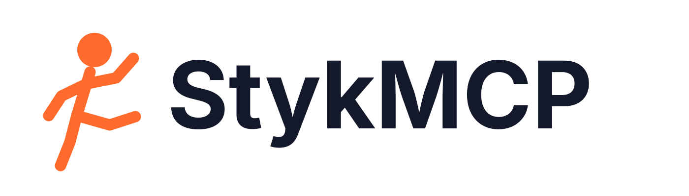

<p align="center">
  
</p>

<p align="center">
  The StykAnimate stick-figure engine with an MCP server, so AI agents such as Claude can<br>
  create, edit, preview and export animations in a few tool calls.
</p>

> **Independent fork.** StykMCP is a fork of [StykAnimate](https://github.com/filippocalippo/StykAnimate-App),
> a free, open-source stick figure animation app. It is **not affiliated with or endorsed by** the
> StykAnimate author. For the official app, use [stykanimate.com](https://stykanimate.com) and its
> [releases](https://github.com/filippocalippo/styk-animate-releases/releases/latest); please report
> problems with this fork here, not upstream.

## MCP server

`mcp/` adds a stdio [MCP](https://modelcontextprotocol.io) server that drives the animation engine
headlessly: no editor window, no GPU, compact text replies, one-call batches and preset moves (walk,
run, jump, punch, kick, jump kick, fall, wave, idle, crouch), with MP4, WebM, GIF and PNG export.

```sh
npm ci
npx playwright install chromium        # on Windows, Edge is used if this is missing
npm run test:mcp:smoke                 # builds and exports clips through the tools, prints token cost
claude mcp add stykmcp -- node /absolute/path/to/stykmcp/mcp/server.mjs
```

You also need Python 3.11+ (for Pivot `.piv`/`.stk` files) and ffmpeg on `PATH`. `npm run mcp`
starts the server by hand. Setup for Claude Code and Claude Desktop, the tool reference, example
prompts, troubleshooting and known limitations are in [docs/MCP.md](docs/MCP.md); the design and
measurements are in [docs/MCP-PLAN.md](docs/MCP-PLAN.md). In MCP mode nothing leaves your machine:
telemetry and update checks belong to the desktop shell, which the server never loads.

## Features of the underlying app

- **Pose stick figures** with fixed-length joints, IK for arms and legs, stretchy nodes and 3D figures with depth.
- **Build your own figures** from lines, circles, polygons, text and images, with a shared rig and per-part styles.
- **Two timelines:** a Simple, Pivot-style frame strip and an Advanced timeline with layers, folders, keys and easing.
- **Motion paths, onion skins and camera moves,** including camera follow.
- **Particle effects** (explosions, auras, beams, smoke) and brushes for drawing.
- **Community library:** insert figures and movieclips shared by other animators.
- **Export** MP4, WebM (with transparency), GIF, APNG, PNG/JPEG/SVG frames, and editable `.piv`/`.stk`.
- **27 interface languages**, light and dark themes, a touch interface for phones and tablets.

Everything (decoding, editing, saving and rendering) runs locally. Optional, consent-based diagnostics are described in [docs/telemetry.md](docs/telemetry.md).

## Official StykAnimate builds

These are the upstream app, not this fork:

- **Windows and Linux:** download Setup, Portable or the AppImage from the [releases page](https://github.com/filippocalippo/styk-animate-releases/releases/latest). Installed apps update themselves.
- **Browser:** open [app.stykanimate.com](https://app.stykanimate.com). It works offline once loaded.

## Build from source

Requirements: Node.js 22+ (CI uses 24.11) and Python 3.11+ (CI uses 3.12). Windows and Linux are tested on every change; macOS has an untested build target.

```sh
npm ci
python -m pip install -r backend/requirements-fast.txt
npm start            # desktop app (Electron)
npm run serve        # or the editor in your browser at http://127.0.0.1:47831
```

Set `STYK_PYTHON` to choose a Python interpreter. Optional native helpers speed up large imports (`npm run build:frame-scan`); the Python fallbacks always work.

Packaging, on the matching operating system:

```sh
python -m pip install -r scripts/requirements-build.txt
npm run build:sidecar
npm run pack && npm run verify:package
npm run dist:win     # or dist:linux, dist:mac
```

The browser build: `npm run web:build`, then `npm run web:preview`. See [Web build](docs/WEB.md), [Linux](docs/LINUX.md) and [Touch interface](docs/TOUCH.md).

## Tests

```sh
npm run check        # syntax, stylesheet lint
npm test             # unit tests (includes the MCP tool layer)
python -m unittest discover -s backend -p "test_*.py"
npm run test:mcp:smoke   # MCP end-to-end: needs Chromium, ffmpeg and Python
```

Browser tests (`tests/*.browser.mjs`) run against `npm run serve` with Chrome or Playwright Chromium, for example `node tests/timeline.browser.mjs`. Some tests read a local corpus of Pivot projects that is not distributed; they skip and name the missing file. [`.github/workflows/ci.yml`](.github/workflows/ci.yml) shows what runs on every pull request.

## How the code is organized

| Location | Responsibility |
| --- | --- |
| `src/editor*.mjs`, `src/pivot/` | Document model, commands, undo/redo, rigs, native evaluation and validation |
| `src/renderer*.mjs`, `src/prepared-frames.mjs` | WebGPU rendering, incremental edits, GPU playback packets |
| `src/playback*.mjs`, `src/document-transport.mjs` | Worker evaluation, playback caches, bounded document snapshots |
| `src/import-*.mjs`, `backend/`, `codecs/`, `native/` | Pivot and Stick Nodes decoding, the Python codec service, native helpers |
| `src/document-export*.mjs`, `src/image-*.mjs`, `src/video-export.mjs` | Saving, recovery and image/video export |
| `src/app.mjs`, `src/shell/`, `src/ui/`, `src/styles/` | Interface, workspaces, timelines and styles |
| `src/locales/`, `src/localization*.mjs` | Translations |
| `desktop/` | Electron main process, preload bridge, file access, updates |
| `mcp/` | StykMCP: the MCP server, its tool layer, headless render page and tests |
| `web/` | Browser build: service worker and Cloudflare configuration |
| `tests/`, `scripts/` | Tests, smoke tests, benchmarks, build and release scripts |
| `docs/` | Feature contracts and architecture |

Start with [docs/ARCHITECTURE.md](docs/ARCHITECTURE.md). Feature behavior is documented in `docs/`, for example [the timeline](docs/TIMELINE.md), [scene editing](docs/SCENE-EDITING.md) and [the renderer](docs/renderer.md).

## Contributing

Bug reports, ideas, translations and pull requests are welcome. Read [CONTRIBUTING.md](CONTRIBUTING.md) first, and follow the [Code of Conduct](CODE_OF_CONDUCT.md). Report security problems privately as described in [SECURITY.md](SECURITY.md).

## License

StykMCP, like StykAnimate, is free software: you can redistribute it and/or modify it under the terms of the [GNU General Public License](LICENSE), version 3 or (at your option) any later version. Bundled third-party components keep their own licenses; see [THIRD_PARTY_NOTICES.md](THIRD_PARTY_NOTICES.md).

**Modifications in this fork** (October 2026, from upstream commit `def97214`): added `mcp/`, `docs/MCP.md`, `docs/MCP-PLAN.md` and `scripts/fork-brand-svgs.mjs`; replaced the brand artwork in `assets/brand/` and the generated icons (`mark.svg`, `symbol.svg`, `desktop/assets/`, `web/icons/`); changed the package name and metadata, npm scripts and development dependencies in `package.json`; updated this README and the changelog. The git history records every change. All original copyright and license notices are kept.

## Trademarks

The StykAnimate name and logo identify the official project. The GPL lets you fork and redistribute the code, but please give modified versions a different name and icon so people can tell them apart from official releases.

Following that request, this fork is named StykMCP and ships its own icon; it does not include the StykAnimate logo. "StykAnimate" still appears where it names the upstream project, the file formats (`.styk`, `.stkz`) and, for now, the desktop app's interface text.

StykAnimate is an independent project. It is not affiliated with or endorsed by Pivot Animator or Stick Nodes; those names are used only to describe file compatibility.
